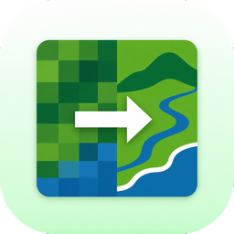

<h1 align="center">SR Module for Landsat</h1>

  

  <strong>Enlarge RGB and monochrome Landsat images four times for clearer display.</strong> 
  Processing runs offline on your computer. No internet connection and no cloud service.

  
  
  
  

Landsat pixels are 30 meters wide, so small features look blocky on screen. SR Module for Landsat reads a prepared RGB or single-band raster, adds estimated detail with the Real-HAT model, and writes a GeoTIFF that is four times wider and four times taller. Use it for maps, presentations, and visual inspection.

What you can do:

- Enlarge an RGB raster or a single band by a factor of 4.
- Process 8-bit and unsigned 16-bit rasters.
- Pick a loaded QGIS layer or a file on disk.
- Process large rasters in blocks, with progress and cancel in QGIS Tasks.
- Run on a DirectML GPU, with automatic fallback to the CPU.

**The output serves visual display only.** The model estimates fine detail from an RGB-trained network. The result holds no verified ground information and no Landsat reflectance values.

---

## Features

| Feature | What it does |
|---|---|
| 4× enlargement | Writes a GeoTIFF with 4 times the width and height. The geotransform keeps the same map extent. |
| Input modes | Automatic, RGB, or Monochrome. Choose the band numbers for each color. |
| Display range | Uses the full bit-depth range by default. You can enter a minimum and a maximum. |
| Device choice | Automatic, GPU (DirectML), or CPU. |
| Masks | Pixels that are NoData or masked in the input become transparent in an alpha band. |
| Report | Saves a JSON report next to the output. It lists the settings, the backend, and the invalid pixel count. |
| Safe output | The plugin never replaces an existing GeoTIFF or report. Choose a new name. |

---

## Requirements

- QGIS 3.34 or later. The metadata allows QGIS up to 4.99.
- 64-bit Windows for the bundled offline runtime.
- A prepared unsigned 8-bit or 16-bit raster. Align and prepare the bands first.
- Free disk space for the output. A 4× enlargement has 16 times as many pixels.

The complete plugin package holds Python, ONNX Runtime, DirectML, and the model file. The source package on the QGIS plugin site and in this repository holds none of them. Without these files, the plugin shows a message and does not process.

---

## Getting started

1. Get the complete plugin package from the project maintainer.
2. In QGIS, open **Plugins → Manage and Install Plugins → Install from ZIP**.
3. Select the ZIP and install it.

---

## Use

1. Open **SR Module for Landsat** from the Raster menu or the toolbar.
2. Select a loaded raster layer or browse to an input file. A selected file takes precedence over the layer.
3. Choose **Automatic**, **RGB**, or **Monochrome**. Then select the band numbers. Monochrome uses **Red / mono band**.
4. Keep **Use full input bit-depth range** selected, or clear it and enter a display minimum and maximum.
5. Choose the device and a new output path that ends in `.tif` or `.tiff`.
6. Select **OK**. Watch progress, or cancel, in QGIS Tasks.

With **Add output to QGIS** selected, the plugin adds the result to the project when the task ends.

---

## Output and limits

- RGB processing uses the three selected bands. Monochrome output has one gray band, plus an alpha band when the input has NoData or a mask.
- Display scaling maps the chosen input range to the output integer range. The default range is 0 to 255 for 8-bit data and 0 to 65535 for 16-bit data.
- The plugin does not read Landsat product metadata. It does not apply scale and offset values. It does not mask QA cloud or shadow flags.
- Predictions near NoData and mask edges can show errors.
- Large rasters take time and disk space.
- Automated load and unload tests ran on QGIS 4.2.3 on Linux. The checks did not run QGIS 3.x. They did not run the processing step, because the offline runtime targets Windows.

---

## Troubleshooting

| Message | What to do |
|---|---|
| The offline runtime or model file is missing | Install the complete plugin package from the project maintainer. |
| Output or its report already exists | Choose a new output file name. |
| Valid input pixels are outside the selected display range | Widen the display minimum and maximum, or use the full bit-depth range. |
| Select 8-bit or unsigned 16-bit bands of the same data type | Convert the bands to one supported type. |
| DirectML GPU acceleration is unavailable | Choose **auto** or **cpu** as the device. |

---

## Contributing

Open an issue at [github.com/vchhikara/SR-Module-for-Landsat/issues](https://github.com/vchhikara/SR-Module-for-Landsat/issues). Include the QGIS version, the raster type, and the message in the QGIS log.

---

## Author

Vipul Chhikara, New Delhi, India.
